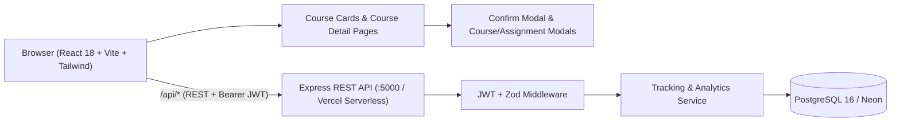
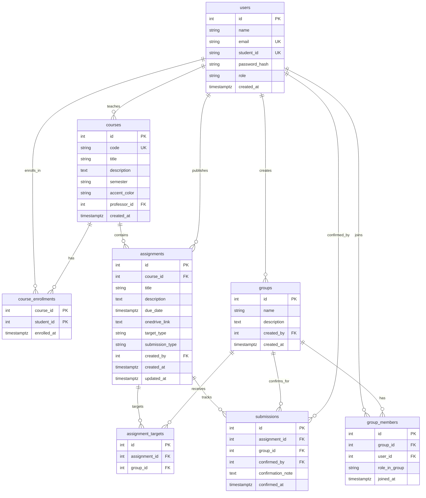
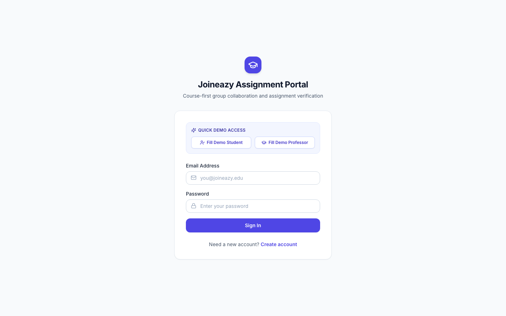
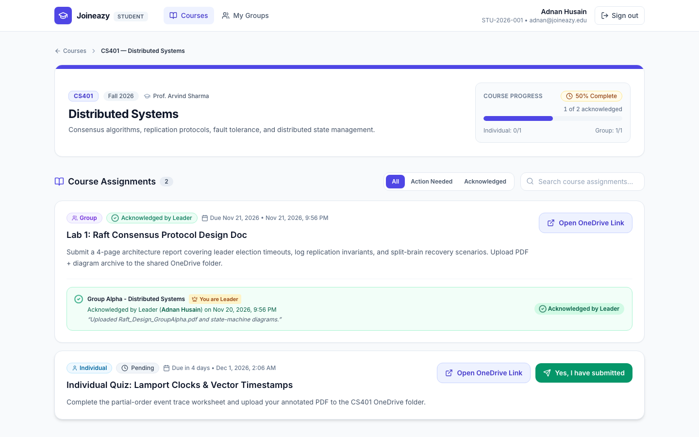
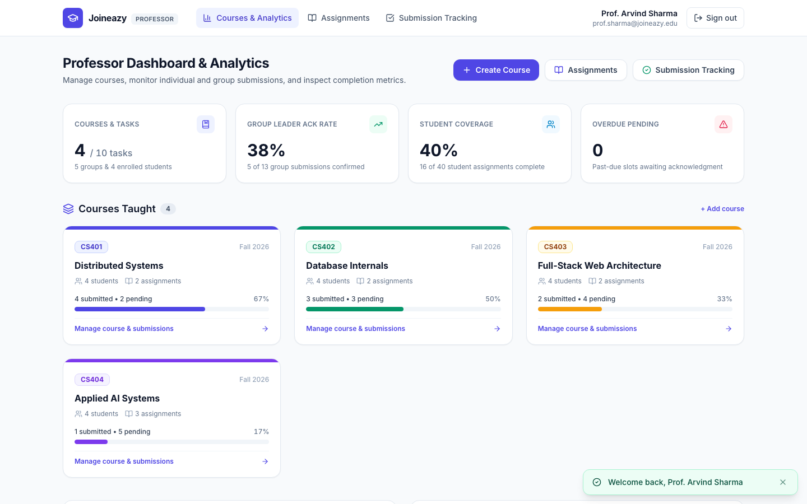

# Joineazy: Course, Group & Assignment Management Portal

Full-stack web application for managing university courses, student teams, OneDrive assignment submissions, leader-only group acknowledgments, and professor tracking analytics.

## Live Deployment
- **Frontend (Vercel):** https://joineazy-task1-sepia.vercel.app
- **Backend API (Vercel Serverless + Express):** https://joineazy-task1-api.vercel.app/api/health
- **Database:** Neon PostgreSQL (`sin1`)

## Implementation Overview

### Student Role
- **Registration & Login:** JWT authentication with `bcryptjs` password hashing, inline field validation, and loading states. Newly registered students are automatically enrolled in existing courses.
- **Course-First Dashboard (`/student`):** Responsive grid of enrolled course cards showing course code, accent strip, professor name, individual/group task counts, progress bar, and completion badge.
- **Course Assignment Workspace (`/student/courses/:courseId`):** Displays assignments scoped to that course with clear `Individual` vs. `Group` badges, due dates, and OneDrive submission links.
- **Individual & Leader-Only Group Acknowledgment:**
  - `Individual` assignments let each student click **"Yes, I have submitted"**, verify their OneDrive upload in a two-step modal, and record their personal acknowledgment.
  - `Group` assignments restrict acknowledgment to the group leader (**"Acknowledge for Group (Leader)"**). Non-leader members see a read-only status pill (**"Group Leader Only — Waiting for `<Leader Name>` to acknowledge"**), and the API rejects non-leader attempts with `403 Forbidden`. Once the leader acknowledges, every member of that group sees the confirmed state.
- **Group Management (`/student/groups`):** Create groups, invite peers by email or `studentId`, remove members (leader or professor), or leave groups. When a leader leaves, leadership transfers to the earliest remaining member.

### Professor (Admin) Role
- **Courses Taught & Course Management (`/admin`, `/admin/courses/:courseId`):** View enrolled student counts, assignment counts, and course submission rates; create new courses with auto-enrollment; enroll individual students by email or `studentId`.
- **Assignment CRUD (`/admin/assignments`):** Create, edit, and delete assignments tied to a specific course, choosing `Group` (`all` or `specific_groups`) or `Individual` (`all` enrolled students) submission type.
- **Group-wise & Student-wise Tracking (`/admin/tracking`):** Switch between group-level and student-level tables, filter by course, assignment, status (`submitted`, `partial`, `pending`, `overdue`), and search by student, group, or leader name.
- **Analytics Dashboard (`/admin`):** Summary KPI cards, Recharts bar charts for per-assignment completion rates and per-group performance, and a recent acknowledgment feed.

## UI/UX Design Choices & Rationale

1. **Course-First Navigation:** Students and professors organize coursework by class rather than a single flat assignment list. Putting enrolled course cards at `/student` and courses taught at `/admin` keeps each workspace focused and cuts visual noise as the number of assignments grows.
2. **Clear Visual Separation of Individual vs. Group Flows:** Every assignment card pairs a submission-type pill (`Individual` in sky blue, `Group` in violet) with role-aware actions. Group members who are not leaders see who holds acknowledgment responsibility instead of a disabled button that fails on click, reducing confusion before any API call happens.
3. **Progressive Two-Step Confirmation Modal:** Opening OneDrive happens on an external tab, so students confirm upload completion inside a dedicated modal rather than a single-click toggle. For group assignments, the modal states which group is selected and notes that confirming marks the task submitted for every teammate.
4. **Restrained Micro-Animations:** Keyframe transitions (`checkPop` on verified checkmarks, `modalIn` on dialog overlays, `fadeIn` on inline validation errors, and `700ms` progress bar fills) confirm state changes without slowing down navigation. Skeleton placeholders hold layout geometry during data fetches.

## Component & System Architecture



## Database Schema



### Schema & Migration Notes
- `backend/src/db/schema.sql` runs `CREATE TABLE IF NOT EXISTS` alongside idempotent `ALTER TABLE assignments ADD COLUMN IF NOT EXISTS` statements (`course_id`, `submission_type`) so existing Round 1 databases upgrade in place without losing data.
- `submissions` enforces two partial unique indexes: `(assignment_id, group_id) WHERE group_id IS NOT NULL` prevents duplicate group acknowledgments, and `(assignment_id, confirmed_by) WHERE group_id IS NULL` prevents duplicate individual acknowledgments.
- Email, `student_id`, and `courses.code` use case-insensitive unique indexes.

## API Endpoints

| Method | Path | Role | Description |
| :--- | :--- | :--- | :--- |
| `GET` | `/api/health` | Public | Verify Express server and PostgreSQL connection |
| `POST` | `/api/auth/register` | Public | Register a student (auto-enrolled in existing courses) or admin account |
| `POST` | `/api/auth/login` | Public | Authenticate with email and password, returns JWT and user |
| `GET` | `/api/auth/me` | Authenticated | Fetch the current logged-in user profile |
| `GET` | `/api/courses` | Authenticated | List enrolled courses (student) or taught courses (admin) with completion stats |
| `GET` | `/api/courses/:id` | Authenticated | Get course details, assignments, and role-aware submission status |
| `POST` | `/api/courses` | Admin | Create a course and auto-enroll all or selected students |
| `POST` | `/api/courses/:id/enroll` | Admin | Enroll a student by email, `studentId`, or user ID |
| `GET` | `/api/groups` | Authenticated | List student groups (student) or all groups (admin) with stats |
| `GET` | `/api/groups/:id` | Authenticated | Get single group details, members, and completion metrics |
| `POST` | `/api/groups` | Authenticated | Create a new group and optionally invite initial members |
| `POST` | `/api/groups/:id/members` | Authenticated | Add a student member by email or `studentId` |
| `DELETE` | `/api/groups/:id/members/:userId` | Authenticated | Leave a group or remove a member (leader/admin) |
| `DELETE` | `/api/groups/:id` | Leader / Admin | Delete a group |
| `GET` | `/api/assignments` | Authenticated | List visible assignments (optional `?courseId=` filter) |
| `GET` | `/api/assignments/:id` | Authenticated | Get assignment details and submission status |
| `POST` | `/api/assignments` | Admin | Create an assignment with `courseId`, `submissionType`, and `targetType` |
| `PUT` | `/api/assignments/:id` | Admin | Update assignment metadata, course, submission type, or targets |
| `DELETE` | `/api/assignments/:id` | Admin | Delete an assignment |
| `POST` | `/api/submissions/confirm` | Student | Acknowledge individual upload or leader-only group upload (`403` for non-leaders) |
| `GET` | `/api/submissions/progress` | Student | Get overall, course-level, and per-group completion progress |
| `GET` | `/api/submissions/tracking` | Admin | Get group-wise and student-wise tracking rows filtered by `courseId`, `assignmentId`, `status`, `search` |
| `GET` | `/api/submissions/analytics` | Admin | Get summary KPIs, per-assignment rates, per-group rates, and recent activity |

## UI Screenshots

1. **Login & Validation Flow:** 
2. **Student Enrolled Courses Dashboard:** 
3. **Student Course Assignments (Individual & Leader-Only Group States):** 
4. **Two-Step Submission Confirmation Modal:** 
5. **Professor Dashboard, Courses & Analytics:** 

## Demo Accounts & Seeded Data

Starting the backend with `SEED_DEMO_DATA=true` (when the `courses` table is empty) seeds 5 accounts, 4 courses (`CS401`, `CS402`, `CS403`, `CS404`), 3 groups, 9 assignments across individual and group types, and sample acknowledgments.

| Role | Name | Email | Student ID | Password |
| :--- | :--- | :--- | :--- | :--- |
| Professor (Admin) | Prof. Arvind Sharma | `prof.sharma@joineazy.edu` | — | `Admin@123` |
| Student | Adnan Husain | `adnan@joineazy.edu` | `STU-2026-001` | `Student@123` |
| Student | Priya Nair | `priya@joineazy.edu` | `STU-2026-002` | `Student@123` |
| Student | Rohan Verma | `rohan@joineazy.edu` | `STU-2026-003` | `Student@123` |
| Student | Meera Iyer | `meera@joineazy.edu` | `STU-2026-004` | `Student@123` |

- **Group Alpha - Distributed Systems:** Adnan Husain (`leader`), Priya Nair (`member`).
- **Group Beta - Data Engineering:** Rohan Verma (`leader`), Meera Iyer (`member`).
- **Capstone Core Team:** Priya Nair (`leader`), Adnan Husain (`member`), Rohan Verma (`member`), Meera Iyer (`member`).

Logging in as Adnan (`adnan@joineazy.edu`) shows both sides of leader enforcement: he can acknowledge group assignments for **Group Alpha**, while **Capstone Core Team** assignments show a read-only waiting status for Priya Nair (`leader`).

## Setup & Running Locally

### Option 1: Docker Compose (Recommended)

Runs PostgreSQL 16, the Express API, and the Nginx-served React frontend with automatic schema migrations and demo seeding.

```bash
docker compose up --build
```

- **Frontend:** `http://localhost:3000`
- **Backend API:** `http://localhost:5000/api/health`
- **PostgreSQL:** `localhost:5432`

To stop and remove volumes:

```bash
docker compose down -v
```

### Option 2: Local Development (Node.js + PostgreSQL)

1. **Create a PostgreSQL database** (for example `joineazy_task1`).

2. **Configure and start the backend:**

```bash
cd backend
cp .env.example .env
# Edit .env with your PostgreSQL credentials or DATABASE_URL
npm install
npm run seed   # Optional if SEED_DEMO_DATA=true is set in .env
npm run dev
```

3. **Configure and start the frontend:**

```bash
cd frontend
cp .env.example .env
npm install
npm run dev
```

- **Frontend Dev Server:** `http://localhost:5173`
- **Backend API:** `http://localhost:5000/api`
