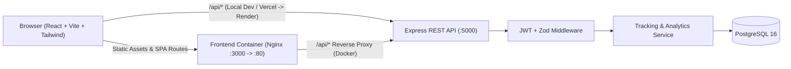
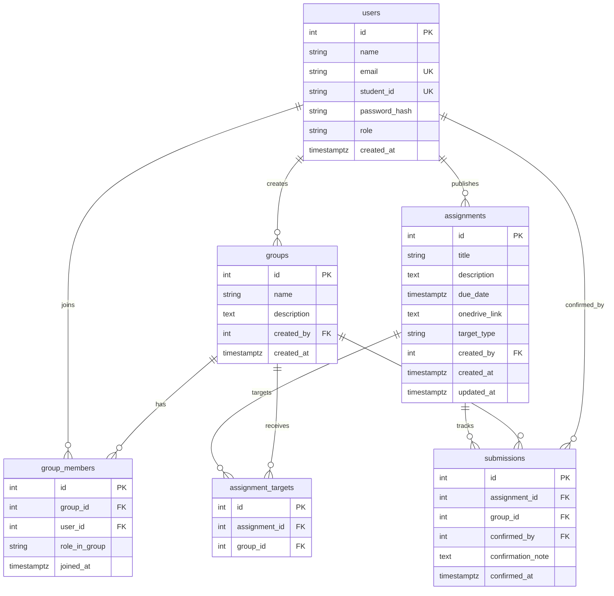

# Joineazy Task 1: Student, Group & Assignment Management System

Full-stack web application for managing university student groups, assignment distribution, OneDrive submission confirmation, and professor-side completion tracking.

## Live Deployment
- **Frontend (Vercel):** https://joineazy-task1-sepia.vercel.app
- **Backend API (Vercel Serverless + Express):** https://joineazy-task1-api.vercel.app/api/health
- **Database:** Neon PostgreSQL (`sin1`)

## Implementation Overview

### Student Role
- **Registration & Login:** JWT authentication with `bcryptjs` password hashing. Students register with name, email, unique `studentId`, and password.
- **Group Management:** Create groups, view member rosters, invite peers by student email or `studentId`, remove members (leader/admin), or leave groups. When a group leader leaves, leadership passes to the earliest remaining member; if the last member leaves, the empty group is removed.
- **Assignment Feed & OneDrive Links:** View assignments targeted to `all` students or any group the student belongs to, with direct external OneDrive submission links.
- **Two-Step Submission Confirmation:** Clicking `"Yes, I have submitted"` opens a confirmation dialog where the student verifies the OneDrive upload, selects the applicable group when enrolled in multiple groups, adds an optional note, and clicks `"Confirm Submission"`. Confirmed items display a verified `"Submitted"` badge with the timestamp and the confirming member's name.
- **Progress Tracking:** Overall completion card and per-group progress bars with completion badges.

### Professor (Admin) Role
- **Assignment CRUD:** Create, edit, view, and delete assignments with title, description, due date, OneDrive URL, and audience targeting (`all` students or `specific_groups` via multi-select group picker).
- **Group-wise & Student-wise Tracking:** Switch between group-level and student-level tracking tables, filter by assignment or status (`submitted`, `partial`, `pending`, `overdue`), and search by student name, Student ID, email, group, or assignment title.
- **Analytics Dashboard:** Summary KPI cards alongside Recharts bar charts for per-assignment completion rates (group completion % and student coverage %) and per-group completion rates, plus a recent confirmations feed.

## Architecture



- **Frontend (`frontend/`):** React 18, Vite, Tailwind CSS, React Router, Lucide icons, and Recharts.
- **Backend (`backend/`):** Node.js, Express 4, Zod request validation, Helmet, CORS, `bcryptjs`, and `jsonwebtoken`.
- **Database:** PostgreSQL with automatic schema initialization (`src/db/init.js`) on startup and an idempotent demo seed script (`src/db/seed.js`).

## Database Schema



### Schema Notes
- `submissions` uses two partial unique indexes: `(assignment_id, group_id) WHERE group_id IS NOT NULL` prevents duplicate group confirmations for the same assignment, and `(assignment_id, confirmed_by) WHERE group_id IS NULL` handles individual submissions by ungrouped students on `all` assignments.
- Email and `student_id` have case-insensitive unique indexes so `STU-2026-001` and `stu-2026-001` cannot collide.

## API Endpoints

| Method | Path | Role | Description |
| :--- | :--- | :--- | :--- |
| `GET` | `/api/health` | Public | Verify Express server and PostgreSQL connection |
| `POST` | `/api/auth/register` | Public | Register a student (requires unique `studentId`) or admin account |
| `POST` | `/api/auth/login` | Public | Authenticate with email and password, returns JWT and user |
| `GET` | `/api/auth/me` | Authenticated | Fetch the current logged-in user profile |
| `GET` | `/api/groups` | Authenticated | List student's groups (student) or all groups (admin) with stats |
| `GET` | `/api/groups/:id` | Authenticated | Get single group details, members, and completion metrics |
| `POST` | `/api/groups` | Authenticated | Create a new group and optionally invite initial members |
| `POST` | `/api/groups/:id/members` | Authenticated | Add a student member by email or `studentId` |
| `DELETE` | `/api/groups/:id/members/:userId` | Authenticated | Leave a group or remove a member (leader/admin) |
| `DELETE` | `/api/groups/:id` | Leader / Admin | Delete a group |
| `GET` | `/api/assignments` | Authenticated | List assignments visible to student or all assignments for admin |
| `GET` | `/api/assignments/:id` | Authenticated | Get assignment details and submission status |
| `POST` | `/api/assignments` | Admin | Create an assignment (`all` or `specific_groups`) |
| `PUT` | `/api/assignments/:id` | Admin | Update assignment metadata, OneDrive link, or target groups |
| `DELETE` | `/api/assignments/:id` | Admin | Delete an assignment |
| `POST` | `/api/submissions/confirm` | Student | Confirm OneDrive upload for a group (or individual if ungrouped) |
| `GET` | `/api/submissions/progress` | Student | Get overall and per-group completion progress |
| `GET` | `/api/submissions/tracking` | Admin | Get filterable group-wise and student-wise submission records |
| `GET` | `/api/submissions/analytics` | Admin | Get summary KPIs, per-assignment rates, per-group rates, and recent activity |

## Demo Accounts

Running the seed script (or starting the stack with `SEED_DEMO_DATA=true` on an empty database) populates these demo accounts, 3 groups, 4 assignments, and partial submissions. The login page includes one-click **Fill Demo Student** and **Fill Demo Professor** buttons.

| Role | Name | Email | Student ID | Password |
| :--- | :--- | :--- | :--- | :--- |
| Professor (Admin) | Prof. Arvind Sharma | `prof.sharma@joineazy.edu` | — | `Admin@123` |
| Student | Adnan Husain | `adnan@joineazy.edu` | `STU-2026-001` | `Student@123` |
| Student | Priya Nair | `priya@joineazy.edu` | `STU-2026-002` | `Student@123` |
| Student | Rohan Verma | `rohan@joineazy.edu` | `STU-2026-003` | `Student@123` |
| Student | Meera Iyer | `meera@joineazy.edu` | `STU-2026-004` | `Student@123` |

## Setup & Running Locally

### Option 1: Docker Compose (Recommended)

Runs PostgreSQL 16, the Express API, and the Nginx-served React frontend with automatic schema creation and demo seeding.

```bash
docker compose up --build
```

- **Frontend:** `http://localhost:3000`
- **Backend API:** `http://localhost:5000/api/health`
- **PostgreSQL:** `localhost:5432`

To stop and remove volumes:

```bash
docker compose down -v
```

### Option 2: Local Development (Node.js + PostgreSQL)

1. **Create a PostgreSQL database** (for example `joineazy_task1`).

2. **Configure and start the backend:**

```bash
cd backend
cp .env.example .env
# Edit .env with your PostgreSQL credentials or DATABASE_URL
npm install
npm run seed   # Optional if SEED_DEMO_DATA=true is set in .env
npm run dev
```

3. **Configure and start the frontend:**

```bash
cd frontend
cp .env.example .env
npm install
npm run dev
```

- **Frontend Dev Server:** `http://localhost:5173`
- **Backend API:** `http://localhost:5000/api`

## Design & Deployment Decisions

1. **Single Tracking Service for Student, Admin & Analytics:** All eligibility resolution (`all` vs `specific_groups`) and completion math live in `backend/src/services/trackingService.js`. Student progress bars, assignment lists, admin tables, and Recharts datasets read from the same rules so percentages never drift.
2. **PostgreSQL SSL Auto-Detection:** `backend/src/config/db.js` supports both `DATABASE_URL` and `PGHOST`/`PGPORT`/`PGUSER`/`PGPASSWORD`/`PGDATABASE`. When `NODE_ENV=production` with a remote host (Neon, Render, Supabase), SSL (`rejectUnauthorized: false`) turns on automatically. Local Docker containers (`PGHOST=db`, `DATABASE_SSL=false`) keep SSL off.
3. **Zero-Step Schema Bootstrap:** `server.js` runs `CREATE TABLE IF NOT EXISTS` statements from `schema.sql` before listening, so deploying against a fresh managed PostgreSQL instance requires no manual migration CLI step.
4. **Nginx Reverse Proxy & SPA Fallback:** In Docker, `frontend/nginx.conf` serves the Vite production build, falls back to `/index.html` for React Router paths, and proxies `/api/` to `backend:5000`. For standalone static hosting on Vercel, `frontend/vercel.json` handles SPA rewrites.

### Deploying to Neon / Render + Vercel

1. **Database (Neon or Render Postgres):** Provision a PostgreSQL instance and copy its `DATABASE_URL`.
2. **Backend (Render Web Service):**
   - Root Directory: `backend`
   - Build Command: `npm install`
   - Start Command: `npm start`
   - Environment Variables:
     - `NODE_ENV=production`
     - `DATABASE_URL=<your-postgres-connection-string>`
     - `JWT_SECRET=<strong-random-secret>`
     - `CORS_ORIGIN=https://<your-vercel-domain>.vercel.app`
     - `SEED_DEMO_DATA=true` (seeds demo records once if `users` is empty)
3. **Frontend (Vercel):**
   - Root Directory: `frontend`
   - Framework Preset: `Vite`
   - Environment Variable: `VITE_API_URL=https://<your-render-service>.onrender.com/api`
   - `frontend/vercel.json` automatically rewrites client-side routes to `/index.html`.
